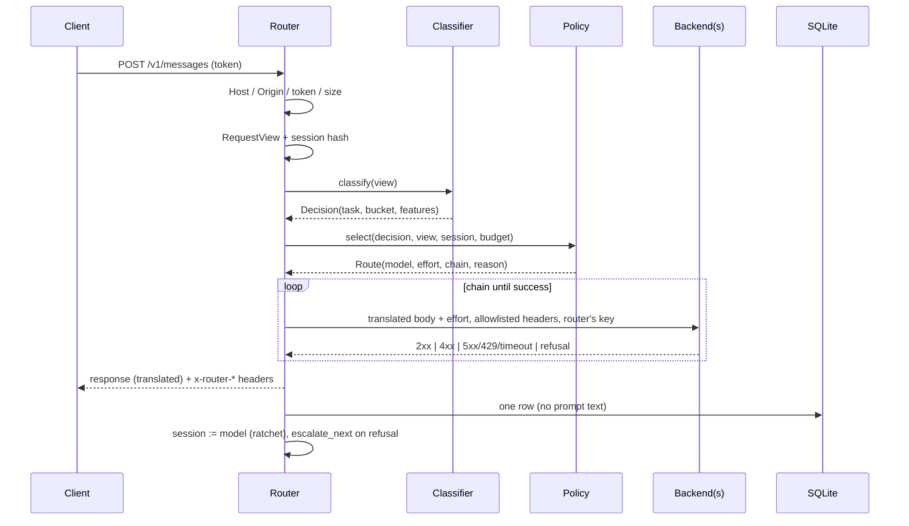

# Architecture

```text
agent_model_router/
  proxy.py            Starlette app: guards, endpoints, the attempt loop, streaming, logging
  view.py             RequestView: both dialects -> last human turn, tool step, context size,
                      hashed session id
  policy.py           select(): cheapest model >= bar, filters, ratchet, chain; SessionStore
  backends.py         prepare_body (translate, swap model, clamp, apply effort), Upstream
                      (one httpx client per backend, no redirects, no proxy env)
  config.py           YAML (safe_load) -> frozen dataclasses, URL validation
  security.py         router token, backend URL checks, header allowlists, redaction
  metrics.py          SQLite route log (parameterised), summary, `stats` formatting
  sse.py              incremental SSE parser / encoder
  cli.py              serve | init | token | explain | stats | train | eval
  classifier/
    features.py       18 named features in [0, 1] (size, tools, keywords, traceback, ...)
    linear.py         LinearScorer (logistic regression, JSON weights, fitted cut points)
    heuristic.py      task rules + scorer + sensitive-topic floors + secret flag
    decision.py       local decision model: scrubbed prompt, JSON answer, floors, fallback
    dataset.py        deterministic synthetic training set
    training.py       train_rows / evaluate
  translate/
    requests.py       Anthropic <-> OpenAI request bodies
    responses.py      non-streaming responses, usage, error envelopes
    streams.py        Passthrough, OpenAIToAnthropic, AnthropicToOpenAI SSE adapters
  data/
    default.yaml      the default pool (ollama; hosted Anthropic disabled)
    synthetic.jsonl   1,500 labelled rows (regenerable)
    eval.jsonl        33 hand-written labelled prompts
    weights.json      the shipped scorer
```

## One request



## Decisions

- **Classify the human turn, not the request.** Tool-loop requests (last message is a
  tool result) carry no new human intent. They keep the conversation's model, so a
  loop never changes models halfway through and the prompt cache stays warm.
- **Linear and explainable over clever.** 18 features and a logistic scorer: every route
  can be explained as "kw_hard +2.3, chars +1.1". The weights are JSON, the training set
  is generated by code in the repo, and a test retrains it from scratch and compares
  with the shipped weights.
- **Advice, not authority.** Like jev-router, the router treats the classifier's output
  as untrusted advice. Guards only raise. The decision model can lower the bucket by at
  most one step. Secrets restrict routing to trusted backends.
- **Escalate before the first byte.** Retries happen only while nothing has been sent
  to the client. After that, a stream is committed. A refusal there marks the
  conversation so its next turn starts one model up.
- **Stateless restarts.** Sessions live in a bounded in-memory LRU of hashes. A restart
  just routes every conversation afresh.
- **No new infrastructure.** The router is one process on loopback, the database is
  SQLite, and it needs no hosted service. Hosted backends are optional and use the
  operator's own key.
