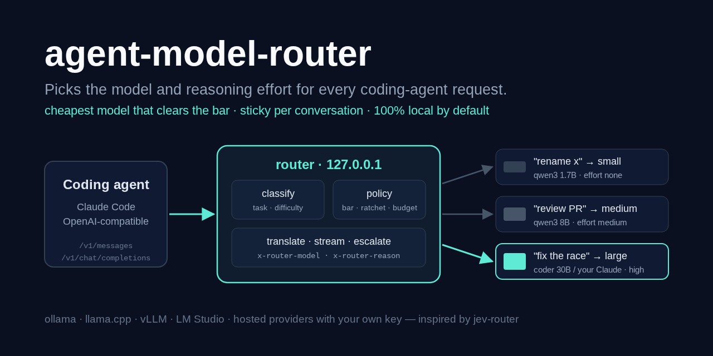
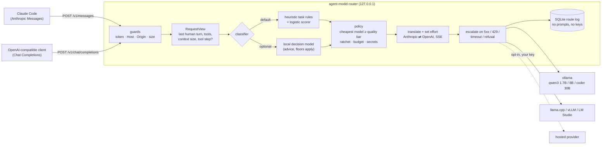

# agent-model-router

> A local proxy for coding agents that picks the model **and** the reasoning effort for every request: an explainable classifier, the cheapest model in your pool that clears the quality bar, sticky per conversation, Anthropic and OpenAI APIs in and out, ollama by default.

[](https://github.com/MartinCastroAlvarez/agent-model-router/actions/workflows/ci.yml)
[](LICENSE)
[](pyproject.toml)
[](pyproject.toml)



Point Claude Code (`ANTHROPIC_BASE_URL`) or any OpenAI-compatible client (`base_url`) at
`agent-model-router`. For each request it works out what kind of turn this is (chat,
edit, plan, debug, review, or a tool-loop step), how hard it is, how much context it
carries and whether tools are in play. It then sends the request to the cheapest model in
your pool that is good enough, with a matching effort level (`reasoning_effort`, adaptive
thinking + `output_config.effort`, or a thinking budget). A rename goes to a 1.7B local
model with no thinking. A concurrency refactor goes to your strongest model at `high`.

**Runs 100% locally, no paid APIs required.** The default pool is three ollama models.
Hosted providers are optional backends you turn on with your own key. The tests use fake
backends and never touch the network.

The idea comes from [jev-router](https://github.com/dirien/jev-router) by Engin Diri,
described in [Route every Claude Code message to the right model with Jev](https://www.pulumi.com/blog/route-every-claude-code-message-to-the-right-model-with-jev/)
(Pulumi), and from OpenRouter's [Jev Router](https://openrouter.ai/docs/guides/routing/routers/jev-router),
which picks a model and a reasoning effort per request. jev-router asks TypeSafe's hosted
Jev decision model. This project is a Python take on the same idea that needs no hosted
service: a deterministic, explainable default classifier, an optional *local* decision
model, and any mix of local and hosted backends. The two projects share no code.

## Why

- **Most agent turns are easy.** "yes", "rename this", "run the tests again" don't need
  the model you'd use for a system design. Sending everything to the biggest model costs
  money (hosted) or time and VRAM (local).
- **Effort is the second dial.** The same model at `low` effort costs a fraction of what
  it costs at `high`. The router sets both dials.
- **Caches and tool loops matter.** Switching models mid-conversation makes the next
  request start with a cold prompt cache. The router uses a *ratchet*: within a
  conversation the model only moves up, and tool-loop steps stay on the model of the
  human turn that started them.
- **You should be able to read every decision.** Every response carries
  `x-router-model`, `x-router-effort` and `x-router-reason`. `/router/explain` shows the
  features, their weights and every candidate with its estimated cost.

## Quickstart

```bash
pip install "agent-model-router @ git+https://github.com/MartinCastroAlvarez/agent-model-router"
ollama pull qwen3:1.7b && ollama pull qwen3:8b && ollama pull qwen3-coder:30b
agent-model-router init && agent-model-router serve          # 127.0.0.1:8787
ANTHROPIC_BASE_URL=http://127.0.0.1:8787 ANTHROPIC_AUTH_TOKEN=$(agent-model-router token) claude
agent-model-router stats                                      # routes + estimated savings
```

Once v0.1.0 is on PyPI the first line becomes `pip install agent-model-router`. Without
ollama, `python -m examples.local_demo` runs the whole path on real sockets against a
fake backend. OpenAI-compatible clients use `base_url=http://127.0.0.1:8787/v1` and the
same token as the API key.

```text
$ python -m examples.local_demo
anthropic -> small   (trivial, effort none) reply: '[qwen3:1.7b effort=none] Done.'
openai    -> medium  (medium, effort medium) reply: '[qwen3:8b effort=medium] Done.'
anthropic -> large   (hard, effort high) reply: '[qwen3-coder:30b effort=none] Done.'
stream    -> Anthropic events: message_start content_block_start content_block_delta ...
explain   -> large | hard edit: cheapest model with quality >= 0.75
```

> Claude Code is built for Claude models. Anthropic does not support routing it to
> other models through a gateway, and smaller open-weight models follow its tool
> protocol less reliably. A pool of Claude models (hosted backend) is the fully
> supported setup; local models are for experiments and for other agents.

## How it works



1. **Guards.** The router binds to `127.0.0.1` and requires a local token (`x-api-key` or
   `Authorization: Bearer`). It refuses foreign `Host` headers (DNS rebinding), any
   browser `Origin`, and oversized bodies.
2. **View.** Both dialects are reduced to the latest human message, earlier human turns,
   whether this is a tool-loop step, tool presence, image count and an estimated context
   size. The session id is a hash of `X-Claude-Code-Session-Id` / `x-session-id` /
   `metadata.user_id` / `user`, or of the system prompt plus the first message.
3. **Classify.** The default classifier uses keyword and structure rules for the task and
   an 18-feature logistic-regression scorer for difficulty. The scorer is trained on the
   bundled synthetic dataset (1,500 rows, regenerated deterministically by
   `agent-model-router train`). Bucket cut points are fitted on the same data. Guards can
   only raise the bucket: one sensitive topic (production, credentials, billing...) sets
   a floor of `medium`, two set `hard`. A secret-shaped string in the prompt marks it
   `secret`.
4. **Decision-model mode** (`classifier.mode: decision`). A small local model (for
   example `qwen3:1.7b`) gets a scrubbed copy of the message: secrets redacted, code
   blocks replaced by a one-line summary, 2,000 characters at most, and no tool output,
   files or system prompt. It answers `{"task", "difficulty"}`. Its answer is advice.
   Timeouts and invalid answers fall back to the heuristic, sensitive floors still
   apply, and it can lower the heuristic's bucket by at most one step. This is the
   router's version of jev's System One.
5. **Policy.** The router picks the cheapest model whose `quality` clears the bar for the
   bucket, among models that fit: context window, tool support, the daily budget, and
   *trusted backends only* when a secret was detected. Ratchet stickiness keeps the
   conversation's model when it is at least as strong. The fallback chain goes up in
   quality, then down. The effort comes from the bucket.
6. **Translate.** The router speaks Anthropic Messages and OpenAI Chat Completions on both
   sides. It translates text, images, system prompts, tools, tool calls, tool results,
   `tool_choice`, stop sequences and streaming. Same-dialect streams pass through byte
   for byte, and cross-dialect SSE is re-emitted event by event (`input_json_delta`
   ⇄ `tool_calls` deltas). The client's `thinking` / `reasoning_effort` is replaced by the
   router's choice.
7. **Escalate.** Connection errors, timeouts, 408/409/425/429/5xx/529 and refusals
   (`stop_reason: refusal`, `content_filter`, or a short reply that opens with a refusal
   phrase) move to the next model in the chain before any byte reaches the client. A
   refusal inside a stream can't be retried, so the conversation's next turn escalates.
8. **Log.** One SQLite row per request records the hashed session, task, bucket, model,
   effort, status, tokens, estimated cost and the cost of the same tokens on the baseline
   model. `agent-model-router stats` reads it.

### Effort styles (per model)

| `effort:` | Sent to the backend | For |
| --- | --- | --- |
| `reasoning_effort` | `reasoning_effort: low/medium/high` (omitted for `none`) | ollama, vLLM, llama.cpp, OpenAI-compatible reasoning models |
| `adaptive` | `thinking: {type: adaptive}` + `output_config.effort` (`low` for `none`), sampling params removed | current Claude models (`claude-sonnet-5-5`, `claude-opus-5-5`) |
| `budget` | `thinking: {type: enabled, budget_tokens}` from `policy.thinking_budgets`, `max_tokens` raised to fit | older Claude models (`claude-haiku-4-5-20251001`) |
| `none` | reasoning fields removed | models without a reasoning control |

## Configuration

`agent-model-router init` writes the [default config](agent_model_router/data/default.yaml)
to `~/.config/agent-model-router/config.yaml`. The router reads `--config`,
`$AGENT_ROUTER_CONFIG`, that file, or the bundled default, in that order.

| Key | Default | Meaning |
| --- | --- | --- |
| `server.host` / `port` | `127.0.0.1` / `8787` | anything but loopback needs `allow_remote: true` |
| `server.auth` | `true` | require the router token; `false` only on loopback |
| `server.key_env` / `key_file` | `AGENT_ROUTER_TOKEN` / `~/.config/agent-model-router/token` | where the token comes from (file created 0600 on first use) |
| `server.allowed_origins` | none | browser origins allowed to call (none: every `Origin` is refused) |
| `backends.<name>.kind` | `openai` | `ollama`, `openai` (any compatible server) or `anthropic` |
| `backends.<name>.base_url` | ollama: `http://127.0.0.1:11434/v1` | from config only; plain http only for loopback unless `allow_insecure: true`; hosted kinds need https |
| `backends.<name>.api_key_env` | none | env var holding *your* key; a backend whose key is missing is skipped |
| `backends.<name>.trusted` | loopback: `true` | may receive prompts that contain secrets |
| `models[].quality` | required | 0..1, how hard a task the model handles well |
| `models[].price` | `0` | USD per million input/output tokens (notional for local models) |
| `models[].context` / `max_output` / `tools` | `32768` / `8192` / `true` | fit filters and clamps |
| `models[].effort` | `none` | effort style (table above) |
| `policy.quality` | `0 / .3 / .55 / .75 / .9` | quality bar per bucket (trivial..expert) |
| `policy.effort` | `none / low / medium / high / high` | effort per bucket |
| `policy.sticky` | `ratchet` | `ratchet` (only up within a conversation) or `off` |
| `policy.idle_reset_minutes` | `30` | an idle conversation is routed afresh |
| `policy.max_attempts` | `3` | length of the fallback chain |
| `policy.baseline_model` | priciest usable | what savings are measured against |
| `classifier.mode` | `heuristic` | or `decision` with `decision_model: <pool name>` |
| `budgets.daily_usd` | none | when spent (local day): `on_exceeded: cheapest` or `reject` (429) |
| `metrics.db` | `~/.local/share/agent-model-router/routes.sqlite3` | `metrics.enabled: false` keeps it in memory |

Per request: `x-router-model: <pool name>` (or `model: <pool name>` in the body) pins a
model.

### Endpoints

| Endpoint | |
| --- | --- |
| `POST /v1/messages` | Anthropic Messages (stream or not) |
| `POST /v1/messages/count_tokens` | estimate (`x-router-estimate: true`) |
| `POST /v1/chat/completions` | OpenAI Chat Completions (stream or not) |
| `GET /v1/models` | `auto` plus the usable pool |
| `POST /router/explain[?api=openai]` | dry run: decision, features, contributions, candidates, chain |
| `GET /router/stats[?since=<unix>]` | the metrics summary as JSON |
| `GET /healthz` | `{"status": "ok"}`, no token needed |

Response headers: `x-router-model`, `x-router-backend-model`, `x-router-effort`,
`x-router-task`, `x-router-bucket`, `x-router-reason`, `x-router-session`,
`x-router-attempts`.

### CLI

`agent-model-router serve | init | token | explain <file|-> | stats [--hours N] [--json] | train [--data] [--out] | eval [--data] [--weights]`

`explain` accepts a request body or plain text, so `echo "rename x" | agent-model-router explain -`
shows the route offline.

## Classifier quality

| Set | Bucket exact | Within one bucket | Task |
| --- | --- | --- | --- |
| Bundled synthetic (1,500, training set) | 75% | 99% | 94% |
| Hand-written prompts (`data/eval.jsonl`, 33) | 85% | 100% | 100% |

The hand-written set was used while tuning the rules, so treat it as a smoke check, not
a benchmark. Like jev-router's evaluation set, the right quality bars depend on your own
prompts: label a few dozen as JSONL (`text`, `task`, `level` 0..4), run
`agent-model-router eval --data mine.jsonl`, and retrain with `train --data`.

## Testing

```bash
python3 -m venv .venv && . .venv/bin/activate && pip install poetry
poetry install
poetry run pytest                 # 166 tests, coverage ≥ 85% (currently ~97%)
poetry run python -m examples.local_demo
```

- `tests/test_proxy.py`: the ASGI app end to end against fake ollama/OpenAI/Anthropic
  backends (an httpx `MockTransport`). Covers auth, Host/Origin/size guards, routing per
  bucket, header allowlist and key handling, pinning, ratchet and idle reset, tool
  loops, escalation on 5xx/429/connection errors/refusals, streaming in all four
  directions, budgets, the secret rule, and a check that no prompts or keys reach the
  logs or metrics.
- `tests/test_translate.py`: request/response translation both ways, and SSE adapters fed
  at random split points.
- `tests/test_classifier.py`: features, tasks, buckets, guards, the bundled dataset and
  weights (reproduced from scratch), and decision-model mode (valid, invalid, slow,
  failing and prompt-injected judges).
- `tests/test_policy.py`, `test_config.py`, `test_backends.py` (respx), `test_security.py`
  (an AST audit: no `eval`/`pickle`/`subprocess`/`yaml.load`/`shell=True`, no suppression
  comments), `test_cli.py`.

## Part of the series

| Series | Repositories |
| --- | --- |
| Agent tooling | [agent-lint](https://github.com/MartinCastroAlvarez/agent-lint) · [repo-graph-mcp](https://github.com/MartinCastroAlvarez/repo-graph-mcp) · [s3-agent-memory](https://github.com/MartinCastroAlvarez/s3-agent-memory) · [pytest-llm-evals](https://github.com/MartinCastroAlvarez/pytest-llm-evals) · [serverless-mcp-aws](https://github.com/MartinCastroAlvarez/serverless-mcp-aws) · **agent-model-router** |
| Django admin family | [django-admin-react](https://github.com/MartinCastroAlvarez/django-admin-react) · [django-admin-rest-api](https://github.com/MartinCastroAlvarez/django-admin-rest-api) · [django-admin-mcp-api](https://github.com/MartinCastroAlvarez/django-admin-mcp-api) · [django-admin-graph](https://github.com/MartinCastroAlvarez/django-admin-graph) · [django-admin-skills](https://github.com/MartinCastroAlvarez/django-admin-skills) |
| Apps | [local-rag-ollama](https://github.com/MartinCastroAlvarez/local-rag-ollama) · [ui-review-agent](https://github.com/MartinCastroAlvarez/ui-review-agent) |
| Patterns catalog | [agentic-architectures](https://github.com/MartinCastroAlvarez/agentic-architectures): every agent pattern, linking the LangGraph, ADK, CrewAI and LangChain repos |

## Credits

The per-request model and effort routing idea, the ratchet that keeps prompt caches warm,
tool-loop inheritance, "guards can only raise" and the savings report against a baseline
model all come from [jev-router](https://github.com/dirien/jev-router) (Apache-2.0) and
its write-up on the [Pulumi blog](https://www.pulumi.com/blog/route-every-claude-code-message-to-the-right-model-with-jev/),
and from [OpenRouter's Jev Router](https://openrouter.ai/docs/guides/routing/routers/jev-router).
This is an independent Python implementation and copies none of their code.

## Contributing

See [`CONTRIBUTING.md`](CONTRIBUTING.md), [`ARCHITECTURE.md`](ARCHITECTURE.md),
[`SECURITY.md`](SECURITY.md) and the agent contract in [`CLAUDE.md`](CLAUDE.md).

## License

MIT © 2026 Martín Castro Álvarez. See [LICENSE](LICENSE).
